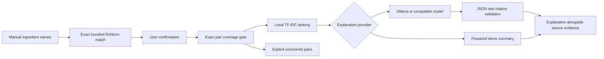

# Medication Evidence Explainer

Team 5 · Roger Carrillo, Brandon Chu, Nhan Nguyen, David Ramos · CECS 458/558

A runnable prototype: enter generic ingredient names, confirm matches, retrieve selected label evidence, and read cited explanations. Runs without an API key in demo mode. The explanation provider can be replaced with a local Ollama model or a hosted OpenAI-compatible service through configuration.

## Run locally

Python 3.11–3.13 recommended. From this repository:

```bash
python3 -m venv .venv
source .venv/bin/activate
python -m pip install -r requirements.txt
python -m streamlit run app.py --server.address 127.0.0.1
```

On Windows activate with `.venv\Scripts\activate`. Open the local URL printed by Streamlit. No `.env` is needed for the default demo. Internet is needed to install dependencies; the demo uses bundled data.

## Reproduce a sample

1. Click **Load supported example** (warfarin and aspirin).
2. Click **Review medications**, inspect the ingredients, and check confirmation.
3. Click **Find evidence and explain**. Expect E001, its DailyMed source, and a clearly labeled explanation.
4. Try **Load coverage example** (aspirin and lisinopril). Expect outside coverage and no explanation.
5. Try `asprin` or `warfarin 5mg`. Continuation is blocked rather than guessing or dropping an ingredient.

Recognized: warfarin, aspirin, ibuprofen, acetaminophen, lisinopril. Evidence exists for only warfarin + aspirin and warfarin + ibuprofen. Other recognized names exercise coverage limits; recognition does not imply their combinations are evaluated.

## Choose an explanation provider

Copy `.env.example` to `.env`, configure one option, then restart the app. Never commit `.env`. Shell environment variables override `.env`.

- `AI_PROVIDER=demo`: default; returns prepared evidence summaries, with no generative model or network call.
- `AI_PROVIDER=ollama`: set `AI_BASE_URL=http://localhost:11434` and `AI_MODEL` to an installed model such as `llama3:latest`. Start Ollama separately. No cloud API key is required. Hardware, model availability, and JSON reliability vary.
- `AI_PROVIDER=compatible`: set `AI_BASE_URL` to a trusted OpenAI-compatible server base URL ending in `/v1`, `AI_MODEL` to an available model, and `AI_API_KEY` if required. Calls `/chat/completions` with JSON mode. Providers must implement this contract; arbitrary native APIs require another adapter.

Hosted endpoints require HTTPS; localhost may use HTTP. Requests do not follow redirects. Only confirmed names and retrieved evidence are sent to a configured provider. Lists are not written to disk; provider retention policies still apply.

## Architecture and files



- `app.py`: interface, confirmation, session state, and fallback display. Input edits clear results.
- `services/evidence.py`: exact name and pair matching, coverage, and local TF-IDF cosine ranking. Similarity only orders evidence; it is not medical confidence.
- `services/providers.py`: common `explain(records)` contract, three adapters, prompt, and response validation.
- `data/evidence.json`: ingredient identifiers, two records, label excerpt, table entries, source URL, version, and dates.
- `tests/test_mvp.py`: workflow, coverage, citations, provider errors, and interface checks.
- `docs/milestone-2-plan.md`: proposed workstreams and submission checklist.

Team implementation includes confirmation, coverage gating, NLP retrieval ranking, provider abstraction, citation validation, session invalidation, and sample flows. TF-IDF is a simple NLP baseline; two records do not establish model performance. Prepared demo summaries are not AI-generated outputs.

## Model workflow and limits

The prompt in `services/providers.py` requests one short explanation per record with an evidence ID, without extra mechanisms, doses, treatment changes, or safety claims. Validation checks JSON shape, exact citation coverage, repeated IDs, text length, completion status, and unexpected links. Displayed links come from the catalog. These checks do not establish factual support for every generated statement; human review is still required.

Provider failures retain source passages and show an error; demo summaries are never silently substituted for failed generation. A successful live test on the selected model is required before claiming live LLM integration.

Educational prototype only. No OCR, live RxNorm lookup, dose/formulation matching, food/allergy screening, accounts, or patient-specific assessment. Ingredient IDs were verified against the official RxNorm API November 19, 2026. Evidence was inspected against DailyMed but has not been clinically reviewed by a pharmacist. Cached records are not refreshed automatically. Missing evidence does not establish safety.

## Verify

```bash
python -m unittest discover -s tests -v
```

Tests run without keys, model downloads, or network calls. They verify software behavior, not clinical accuracy. Capture the supported example, an uncovered pair, and actual provider label for the progress report; separate demo and live results.

## Sources

- [DailyMed warfarin label](https://dailymed.nlm.nih.gov/dailymed/drugInfo.cfm?setid=61ab23a7-bc67-4777-854a-bf43c788a69a), section 7.3 / Table 3, version 3, updated November 9, 2026; retrieved November 19.
- [RxNorm lookup](https://lhncbc.nlm.nih.gov/RxNav/APIs/api-RxNorm.findRxcuiByString.html). This product uses publicly available data from the U.S. National Library of Medicine (NLM), National Institutes of Health, Department of Health and Human Services; NLM does not endorse this product.
- [Ollama chat](https://docs.ollama.com/api/chat) and [compatible chat contract](https://platform.openai.com/docs/api-reference/chat/create).
